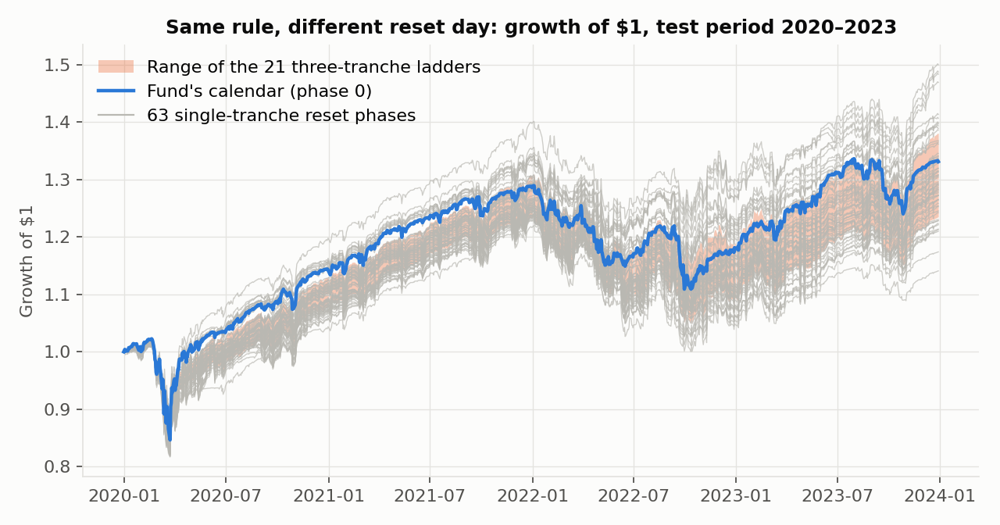
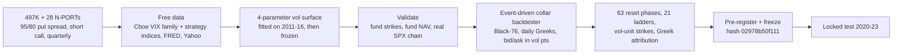
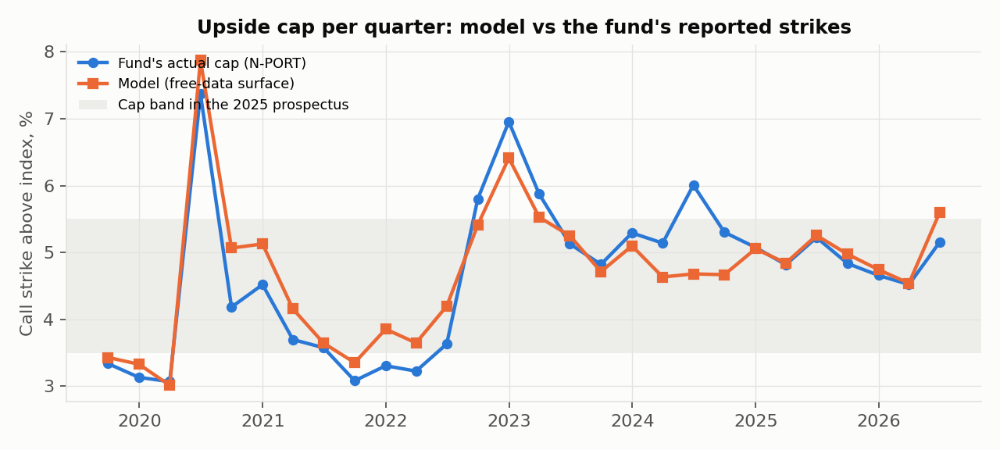
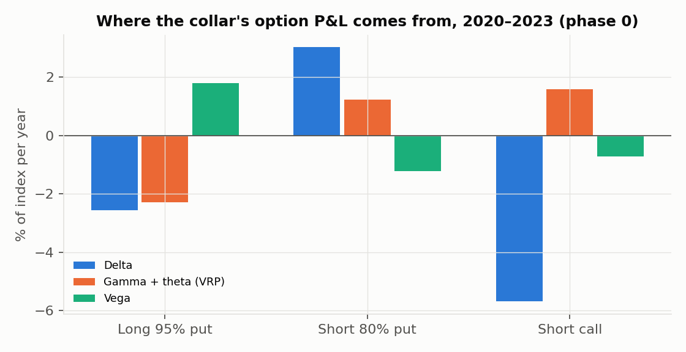

# Collars Under the Microscope

### A $20bn fund hedges the S&P 500 with a put-spread collar that resets on fixed calendar quarters. How much of its result is luck in the reset day, and is the hedge worth it?


-2ea44f)


> **TL;DR.** We rebuilt a large hedged-equity fund's SEC-disclosed collar (buy a 95% put, sell an 80% put, sell a
> call that pays for both, reset each quarter) with a free-data volatility surface. The surface reproduces the
> fund's actual N-PORT call strikes to **0.34 cap points over 28 quarters**, its NAV at **0.989 monthly
> correlation**, and a real Cboe SPX chain to **0.71 vol points**. In the locked 2020-23 test the *same rule*
> returned **3.4% to 10.7% a year depending only on the reset day**. A three-tranche ladder cut that dispersion
> 1.73× at no significant cost, and against a beta-matched stock/T-bill mix the collar added no Sharpe.



---

## 1. The research: what the filings say

* **Form 497K (summary prospectus):** the fund holds S&P 500 stocks and an index collar: a long put about 5% below
  the market, a short put about 20% below, and a short call struck so the package costs roughly nothing, with hedge
  periods fixed to **calendar quarters**.
* **Form N-PORT (28 quarterly holdings filings):** quarter-end expiries at 0.95 / 0.80 × the index, exactly as
  described; total assets $20.27bn.

Verbatim quotes, accession numbers and the strike table: [`research/institutional_methodology.md`](research/institutional_methodology.md).

## 2. The gap

| What is missing | Why it matters |
|---|---|
| **Reset-timing luck is unmeasured for collar funds.** It is documented for rebalancing (Hoffstein, Faber & Braun 2020), not for a public, fixed option calendar. | Investors judge the fund on one draw from 63 possible reset days. |
| **Option data costs money.** Academic collar studies use OptionMetrics. | A free-data pricer must prove itself against real strikes before its backtest means anything. |
| **The right benchmark is rarely used.** A collar with delta ≈ 0.45 should be compared with ~45% equity + T-bills, not the S&P 500. | Against the wrong benchmark any hedge looks either brilliant or useless. |
| **Fixes are untested.** Laddering and volatility-scaled strikes are proposed, not tested out of sample. | |

## 3. Our solution



| Validation of the free-data pricer | Result |
|---|---|
| Model call strike vs the fund's actual strike, 28 quarters | mean absolute error **0.34 pp**, correlation 0.92 |
| Reconstructed collar vs the fund's NAV, 2020-23 | monthly correlation **0.989** |
| Frozen surface vs a real Cboe SPX chain (388 strikes, free delayed quotes) | **0.71 vol points** |
| Manager's two sister funds (same collar, calendars offset 1 and 2 months) | tracked at 0.985-0.987 |



## 4. Results (locked test 2020-23)

| | Hypothesis | Result | Verdict |
|---|---|---|---|
| **Timing luck** | - | same rule, 63 reset days: **3.4% to 10.7%/yr**; max drawdown -12.5% to -19.8% | Large |
| **H1** | A 3-tranche ladder cuts dispersion ≥ 2× at no cost | ratio **1.73** [1.39, 3.05]; cost -1.45%/yr (p 0.285) | Partially supported |
| **H2** | Volatility-scaled strikes give more stable hedging | more stable in 16% of phases (76% in-sample) | Not supported; reverses out of sample |
| **H3** | The collar beats a beta-matched stock/T-bill mix | Sharpe 0.56 vs 0.51, diff +0.05 [-0.37, 0.40]; CVaR 5.6% vs 4.3% | Expensive low-beta |

|  |  |
|---|---|

## 5. What we learned

1. **The reset day is a 7-point-a-year lottery** for an identical rule, and the fund's calendar ranked 21st of 63.
2. **The manager already runs our fix.** Its two sister funds use the same collar on offset calendars; their live NAVs
   differ by about 1 pp a year purely from the reset day.
3. **Laddering helps, but not 2×.** Averaging three independent tranches gives at most √3 ≈ 1.73×, which is what we got.
4. **Who earns the variance premium:** the long 95% put costs 2.3%/yr; the short 80% put (+1.2%) and short call
   (+1.6%) earn it. The hedged fund is partly a crash-skew seller.


## 6. How we kept it honest

* Pre-registration frozen (hash `02978b50f111`) before 2020-23 could load; code and config hashes in
  `research/sources/prereg_freeze_sha256.txt`.
* `tests/test_engine.py::test_no_lookahead` shocks all data after a date and checks every earlier NAV is unchanged.
* **Caveat we pre-committed to:** test-period tracking error to the Cboe collar index was 3.7%/yr, above the 2%
  threshold, so test results are labelled *indicative* (0.6-1.5%/yr outside 2020-23).
* Every run, including failures: [`research/experiment_log.md`](research/experiment_log.md).

## 7. Reproduce

```bash
pip install -e ./qcore -e .
echo "SEC_USER_AGENT=Your Name your@email" > .env
python scripts/run.py download
python scripts/extract_sec_quotes.py
python -c "from collars.data import nport; nport.build()"
python scripts/calibrate.py
python scripts/run.py fit-strikes
python scripts/run.py track   --period development,validation
python scripts/run.py analyse --period development,validation
PREREG_HASH=02978b50f111 python scripts/run.py analyse --period test,recent
PREREG_HASH=02978b50f111 python scripts/run.py robust  --period test
PREREG_HASH=02978b50f111 python scripts/nport_strikes.py --period test
python scripts/sister_funds.py
python scripts/validate_real_chain.py
python scripts/figures.py
pytest
```

## 8. Repository map

```
src/collars/data/       Cboe, FRED, Yahoo, SEC N-PORT downloads and parsers
src/collars/pricing.py  Black-76, Greeks, zero-cost strike solver
src/collars/surface.py  sigma(K, tau) = c * sigma_VS(tau) + a x + b x^2 on the VIX term structure
src/collars/indices.py  Cboe strategy-index replication for calibration
src/collars/engine.py   event-driven backtester (close-bar convention, bid/ask fills, dividends)
src/collars/strategy.py collar, phases, ladders, vol-unit strikes, beta-matched benchmark
src/collars/analysis.py stationary block bootstrap, CVaR, hedge effectiveness; attribution.py: Greek P&L
research/               methodology, pre-registration, experiment log, results, limitations, post-hoc validation
```

**Limitations** ([full list](research/limitations.md)): parametric surface, not a history of real quotes; hypothetical
expiries for off-calendar phases before 2022; S&P 500 total return in place of the fund's stock selection; 16 test
resets, so Sharpe CIs are wide.

**References:** Israelov & Klein (2016) *Risk and Return of Equity Index Collar Strategies* · Israelov (2019)
*Pathetic Protection* · Hoffstein, Faber & Braun (2020) *Rebalance Timing Luck* · Carr & Wu (2009) *Variance Risk Premiums*.

*Research artifact, not investment advice.*
