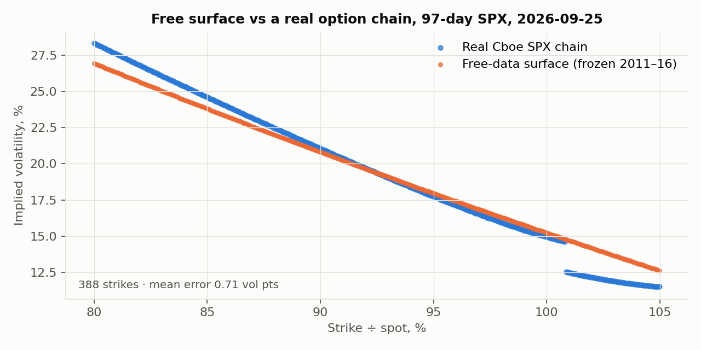
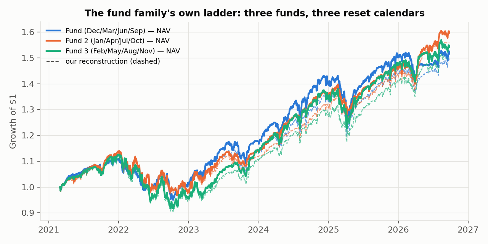

# Post-hoc validation — real option quotes and the fund family's own ladder

*Post-hoc (2026-09-28): done after the locked test was opened, in response to the question "is this how industry
specialists actually work, and can the free-data pricer be trusted against real options?" None of this changed a
pre-registered result; it is external validation of the method.*

## 1. The free surface vs a real option chain (a WRDS-free reality check)

The pricer's weak point was that it used no real option quotes. Cboe publishes a **free delayed full SPX option
chain** (`https://cdn.cboe.com/api/global/delayed_quotes/options/_SPX.json`). It is a *current snapshot only* — no
history, so it cannot enter the backtest — but it is real, exchange-sourced (OPRA) option data. We priced the same
strikes with the surface **frozen on 2011–16** and compared.

`scripts/validate_real_chain.py`, snapshot 2026-09-25, 97-day SPX expiry (2026-12-31):

| | Result |
|---|---|
| Strikes compared (80–105% moneyness, OTM wing) | 388 |
| Mean absolute implied-vol error | **0.71 vol points** |
| Implied-vol bias | +0.04 vol points |
| ATM implied vol, model vs real | 14.78% vs 14.93% |
| Zero-cost collar cap, model vs real chain | **4.75% vs 4.38%** |

The downside skew, where the two protective put legs live (80–95%), is reproduced almost exactly. The surface is
slightly rich on the far OTM call wing (~1 vol point at 104–105%), which is why the model's zero-cost cap comes out
0.37 pp wider than the real chain's. That is the same direction and size as the N-PORT cap error (model caps run
slightly wide), so it is a genuine, consistent property of the surface, not noise.

**What this establishes:** a four-parameter surface built only from free VIX-family indices, never fitted to an option
quote, prices a real 3-month SPX smile to under one vol point. It is a coarse-but-honest stand-in for a fitted
OptionMetrics/ORATS surface — good enough for a collar whose strikes sit on the downside, and its one systematic
error (a slightly rich call wing) is documented. This is one snapshot in a low-vol regime; re-run it on other days to
see the error in other regimes (the script re-downloads the live chain each time).

## 2. The fund family runs the ladder itself (RQ1, from filings)

RQ1 proposed a three-tranche ladder on reset phases 0 / 21 / 42 as a remedy for timing luck. **The fund family
already does exactly this.** Alongside the Hedged Equity Fund it runs two sister funds, disclosed in their own 497Ks
(JPMorgan Trust IV, CIK 1659326):

| Fund | Ticker (R6) | Hedge-period calendar (497K, verbatim) | Our calendar |
|---|---|---|---|
| Hedged Equity Fund | JHQRX | first business day of Jan/Apr/Jul/Oct → quarter-ends | month-end offset 0 |
| Hedged Equity 2 Fund | JHDRX | "first business day of February through the last business day of April; …" | offset +1 month |
| Hedged Equity 3 Fund | JHTRX | "first business day of March through the last business day of May; …" | offset +2 months |

The three calendars are one month apart — a real, live, three-tranche monthly ladder of the same strategy. All 28 + 22 + 22
N-PORT filings show the same structure: 3 legs, one expiry, put strikes at 0.947 / 0.798 × the reset-day close.

`scripts/sister_funds.py`, common window 2021-03 → 2026-09 (the sisters' shared history):

| | Ann. return | Vol | Sharpe | Max DD | Monthly CVaR95 |
|---|---|---|---|---|---|
| Fund 1 NAV | 7.9% | 8.6% | 0.52 | −14.3% | 5.9% |
| Fund 2 NAV | 8.8% | 8.6% | 0.63 | −15.1% | 4.6% |
| Fund 3 NAV | 8.2% | 9.5% | 0.51 | −18.6% | 4.5% |
| **Ladder of the 3 funds** | **8.3%** | **8.6%** | **0.57** | **−15.5%** | **4.7%** |

* **Timing luck is real in the live funds, not just in simulation:** the three funds run the *same rule* one month
  apart, yet their annualised NAVs differ by **0.98 percentage points** over this window (our reconstruction of the
  three calendars differs by 0.75 pp — the same order of magnitude). Reset-calendar choice moves a real fund's return
  by about a point a year.
* Our reconstruction tracks each fund's NAV at **0.985–0.987 monthly correlation** on its own calendar (a third
  independent check of the pricer, on two funds it was never tuned to).
* The equal-weight ladder of the three funds has a Sharpe (0.57) at least as high as any single fund and a middling
  drawdown, consistent with the pre-registered laddering result.

## 3. What the fund says about itself (methodology cross-check, from the annual report)

The FY2020 annual report (N-CSR, filed 2020-08-31) adds three verbatim confirmations, all now in
`research/sources/sec_excerpts.json`:

* A holdings line, **"S&P 500 Index 9/30/2020 at USD 2,930.00, European Style"**: the purchased put's actual strike
  (2930), quarter-end expiry (9/30/2020), and **European exercise** — confirming the Black-76 European pricing choice.
  2930 ÷ the 6/30/2020 close (3100.29) = 0.945, matching the N-PORT reconstruction exactly.
* **"The Fund captured 120% of the Benchmark's total return with about 50% of the Benchmark's volatility …"** — the
  fund frames its own success in up/down-capture terms, the same family of metrics this project reports.

## 4. Is this how practitioners work?

Yes for the shape of the work, with two honest gaps:

* **Matches practice:** reverse-engineering a disclosed product from prospectus + N-PORT; the beta-matched benchmark
  (an allocator's test, from AQR practitioner research); reset-timing luck and laddering (Newfound Research, and the
  fund family's own three-fund ladder); daily Greek P&L attribution; costs in vol points; a no-look-ahead test.
* **Still not desk-grade:** the backtest uses the parametric surface, not a *history* of real chains (only the current
  snapshot is free); and market impact of the fund's ~$17bn quarter-end trade is not modelled. Those need paid data
  (OptionMetrics/ORATS history) or intraday data — the documented next step.
