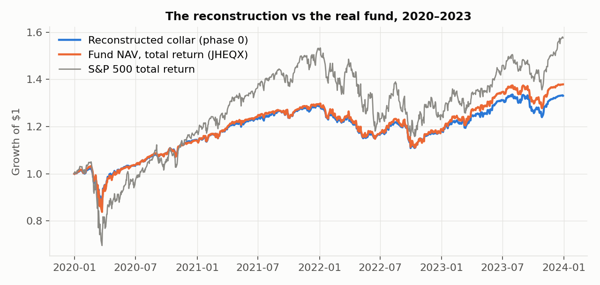
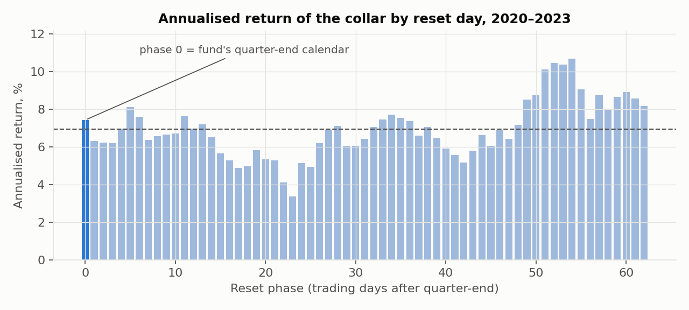
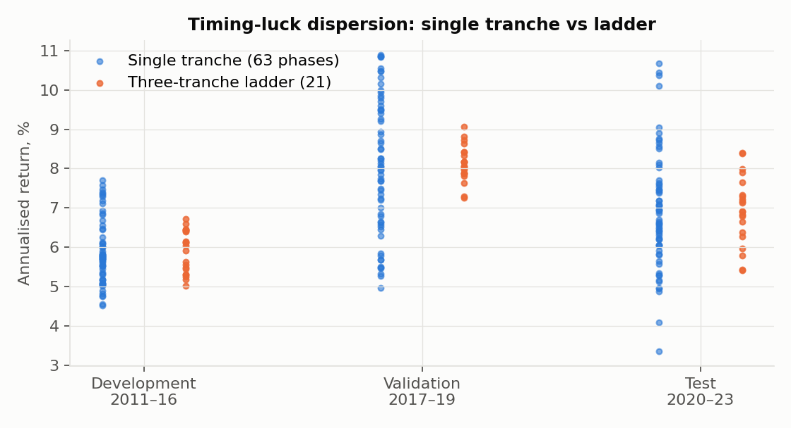

# Results — Collars Under the Microscope

Reset timing luck, strike rules and the value of a systematic put-spread collar, rebuilt from SEC filings with free data.

**Status of the numbers.** Test = 2020–2023, run once after the pre-registration was frozen (hash `02978b50f111`).
Recent = 2024-01 → 2026-09-25, reported separately. Development (2011–16) and validation (2017–19) are in-sample for
design choices and are labelled as such. Options are priced with a free-data parametric surface (Tier B). Test-period
tracking error to Cboe CLLZ was 3.7%/yr, above the pre-registered 2% threshold, so **test results are indicative**.
These are research results, not investment advice.

**Bar and costs.** Strikes, fills and marks use the 16:00 close of each day and that close's VIX-family surface; nothing
after the close enters a decision (`tests/test_engine.py::test_no_lookahead`). Every leg pays a half-spread of
0.464 vol points at the open (fitted on 2011–16), about 19 bp of index per reset in the test period; expiry is cash
settlement at no cost. No market impact is modelled. For scale, the fund itself traded 27,000–45,000 SPX contracts
per leg per quarter (N-PORT), so impact is a real issue for the fund but not for a research-sized overlay.
Trades: 16 resets × 3 legs per phase in the test period, 63 phases.

---

## 1. The reconstruction matches the real fund

| Check | Result |
|---|---|
| SEC quotes (497K 2025, supplement 2026, 497K 2019) | 16 quotes verified word for word by script |
| Fund's actual strikes (N-PORT, 28 quarters 2019–2026) | long put 0.945–0.954 × S, short put 0.795–0.803 × S, one quarterly expiry: the disclosed rule |
| Model call strike vs the fund's actual call strike (given its put strikes) | mean absolute cap error **0.34 pp** over 28 quarters (0.38 pp on test), correlation 0.92 |
| Reconstructed collar vs the fund's NAV (JHEQX), 2020–23 | monthly correlation **0.989**, tracking error 1.36%/yr |
| Pricer vs Cboe indices, out of sample | validation 0.7–1.3%/yr; test 1.8–3.7%/yr; recent 0.6–1.5%/yr |
| Frozen surface vs a **real** Cboe SPX chain (388 strikes, 97-day, 2026-09-25) | implied-vol error **0.71 vol pt**, cap 4.75% vs 4.38% (post-hoc; `posthoc_validation.md`) |
| Reconstruction vs the two **sister funds'** NAVs on their own calendars | monthly correlation **0.985–0.987** (post-hoc) |

The surface has four numbers (ATM ratio 0.816, skew −0.276, curvature −0.011, half-spread 0.46 vol pt), all fitted on
2011–16 monthly Cboe index returns. It had never seen a 3-month option or an N-PORT strike, yet it reproduces the
fund's quarterly call strikes, including the jumps to 7–8% caps after March 2020 and in late 2022. Priced against a
real, current Cboe option chain (free delayed quotes, no WRDS needed) it matches the whole 3-month smile to under one
vol point (`research/posthoc_validation.md`).

The FY2020 annual report confirms the reconstruction independently: a holdings line reads
*"S&P 500 Index 9/30/2020 at USD 2,930.00, European Style"* — the same strike our N-PORT reading gives (0.945 × the
reset close), with European exercise and a quarter-end expiry.

## 2. RQ1 — Timing luck is large; laddering removes about half of it (H1 partially supported)

The disclosed rule, run on each of the 63 possible reset days of the quarter:

| | Development 2011–16 | Validation 2017–19 | **Test 2020–23** | Recent 2024–26 |
|---|---|---|---|---|
| Annualised return, worst … best phase | 4.5% … 7.7% | 5.0% … 10.9% | **3.4% … 10.7%** | 9.9% … 15.4% |
| sd across 63 phases (TL) | 0.82% | 1.70% | **1.50%** | 1.19% |
| sd across 21 ladders | 0.53% | 0.46% | **0.86%** | 0.74% |
| Ratio (95% bootstrap CI) | 1.54 (1.38, 3.16) | 3.67 (1.82, 6.82) | **1.73 (1.39, 3.05)** | 1.61 (1.31, 3.29) |
| Ladder(0,21,42) − fund phase, p | −0.6%, 0.38 | −1.2%, 0.20 | **−1.45%, 0.285** | +0.8%, 0.61 |
| Fund's phase 0 rank of 63 | 14 | 21 | 21 | — |
| Max-drawdown range across phases | 6.1 pp | 7.3 pp | **7.2 pp** (ladders 1.9 pp) | 5.2 pp |

* Over 2020–23 the *same disclosed rule* earned anywhere from 3.4% to 10.7% a year depending only on which day of the
  quarter it reset. That is a 7.3-point spread, half the collar's average return, and it comes from luck rather than skill.
* A three-tranche ladder cuts the return sd by 42% and the drawdown range by 74%, and its mean return is not
  significantly different (p 0.285).
* **Pre-registered verdict: partially supported.** The CI excludes 1 and the ladder costs no significant return, but the
  ratio (1.73) is below the 2× threshold. Robustness: 1.25–2.13 across the moneyness / spread / hedge-ratio grid; 1.56
  excluding 2020. The threshold was ambitious: averaging three tranches alone gives at most √3 ≈ 1.73 if tranche
  deviations are independent, which is almost exactly what the test period shows.
* **This luck is real in the live funds, not only in simulation.** The manager runs two sister funds (Hedged Equity 2
  and 3) on hedge-period calendars one and two months offset — its own three-tranche monthly ladder. Over 2021–26
  their NAVs, on the *same rule*, differ by 0.98 pp/yr purely from the reset calendar (`research/posthoc_validation.md`).

## 3. RQ2 — Volatility-unit strikes: not supported

Hedge-effectiveness stability across VIX-tercile regimes (max − min of 1 − var(collar)/var(S&P)):

| | Development | Validation | **Test** | Recent |
|---|---|---|---|---|
| Share of phases where vol-unit strikes are more stable | 76% | 68% | **16%** | 87% |

The in-sample advantage reversed in the test period. With vol-scaled strikes the put spread moves far out of the money
exactly when VIX spikes (March 2020), so the hedge is weakest when it is needed. **Verdict: not supported**; the evidence
is regime-dependent, not a stable improvement.

## 4. RQ3 — Against the right benchmark, the collar is an expensive low-beta portfolio

Phase 0 vs a portfolio holding the collar's ex-ante delta (≈0.45) in the S&P 500 and the rest in T-bills:

| Test 2020–23 | Collar | Beta-matched | S&P 500 TR | Fund NAV (JHEQX) |
|---|---|---|---|---|
| Annualised return | 7.4% | 6.9% | 12.1% | 8.4% |
| Volatility | 10.3% | 10.4% | 23.0% | 11.1% |
| Sharpe (95% CI) | 0.56 (−0.30, 1.75) | 0.51 (−0.22, 1.48) | 0.53 (−0.22, 1.50) | 0.61 (−0.24, 1.74) |
| Max drawdown | −17.2% | −17.1% | −33.8% | −18.9% |
| Monthly CVaR95 | 5.6% | 4.3% | 10.1% | 5.6% |

* Sharpe difference +0.05, CI (−0.37, +0.40), p 0.76; the monthly tail is *worse* (CVaR 5.6% vs 4.3%); only 4 of 63
  phases reduce CVaR. **Verdict: expensive low-beta** (Israelov & Klein 2016), consistent with development, validation
  and recent (recent Sharpe difference −0.31).
* The collar does halve the S&P 500's drawdown, but so does holding 45% equity and 55% T-bills, and the linear portfolio
  has the thinner monthly tail.

## 5. Where the P&L comes from (phase 0, test)

| % of index / yr | Delta | Gamma + theta (VRP) | Vega | Total |
|---|---|---|---|---|
| Long 95% put | −2.56 | **−2.30** | +1.79 | −3.49 |
| Short 80% put | +3.02 | **+1.22** | −1.23 | +2.67 |
| Short call | −5.69 | **+1.58** | −0.73 | −4.55 |

As predicted, the long 95% put pays the variance risk premium and both short legs earn it. The short 80% put is the
only leg with positive total P&L over 2020–23: the "hedged" fund is partly a crash-skew seller. Ablation (phase 0,
test): removing the short put lowers return from 7.4% to 4.7%; removing the long put raises the max drawdown from
−17% to −42%.

## 6. What this adds

1. An open, reproducible measurement of reset-timing luck in a real, disclosed, very large systematic collar:
   7.3 points of annual return separate the luckiest and unluckiest reset day on the same rule over 2020–23.
2. Evidence that laddering removes about half of it at no significant cost, close to the √3 averaging limit.
3. A free-data pricer that reproduces the fund's actual quarterly strikes to within 0.34 cap points.
4. Confirmation of the beta-matched critique for the put-*spread* collar variant, with leg-level VRP attribution.

See `limitations.md` for what this cannot show.
